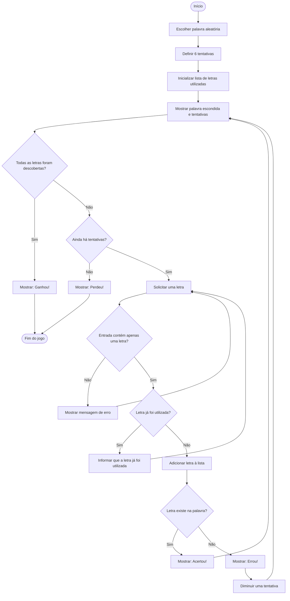

# Fluxograma do Jogo da Forca

## Explicação das etapas

1. Início: o jogo começa.
2. Escolha da palavra: o computador escolhe uma palavra aleatória.
3. Preparação: são definidas 6 tentativas.
4. Ciclo principal: mostra a palavra escondida e pede uma letra.
5. Decisões IF: verifica se a letra é válida, repetida ou correta.
6. Acerto: revela a letra.
7. Erro: retira uma tentativa.
8. Vitória: todas as letras foram descobertas.
9. Derrota: as tentativas chegam a zero.
10. Fim: o jogo termina.